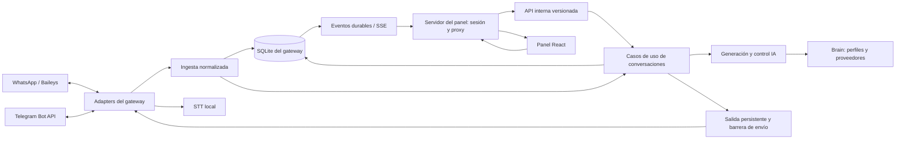

# SDK-Bot: arquitectura de la plataforma de conversaciones

Fecha: 2026-10-19. Estado: **diseño para implementación incremental**.
El código todavía usa `gateway/`, `brain/`, `stt/` y un panel estático.
Las carpetas, tablas, servicios y endpoints de destino no existen todavía,
salvo indicación expresa. Esta sesión entrega documentación, no una migración.

## 1. Producto y primera entrega

SDK-Bot evoluciona hacia una consola de atención multicanal. La pantalla principal
será una bandeja familiar a WhatsApp Web: lista de chats, hilo de mensajes y ficha
del contacto. Desde el hilo se podrá tomar control humano, responder y devolver
la conversación a la IA.

La v1 incluye chats individuales de texto en WhatsApp y Telegram, historial
persistente desde la captura, autoría de salidas, control humano y actualización
en vivo. Habrá un administrador por instalación, con varias pestañas posibles.
No se promete paridad completa con WhatsApp Web ni todo el historial anterior.
Adjuntos reproducibles, grupos, equipos de agentes y herramientas IA con efectos
externos se incorporan después. Desde el inicio, un multimedia recibido tendrá
un marcador visible aunque todavía no pueda abrirse o descargarse.

## 2. Diagnóstico comprobado en el código

| Pieza actual | Evidencia | Implicación |
|---|---|---|
| Memoria IA | `brain/memory.py`: append_exchange, barrido y límites; `.env.tuning`: 7 días y ~5000 tokens de contexto | Es contexto de generación, no archivo íntegro del chat. |
| Historial WA | `gateway/store/chatStore.js`: Map, máximo por chat y expulsión por inactividad | Se pierde al reiniciar; fromMe se normaliza como assistant sin distinguir humano. |
| Captura WA | `gateway/adapters/whatsappAdapter.js`: messages.upsert procesa m.messages[0], filtra mensajes del bot y deriva audio antes de emitir texto | Capturar todos los mensajes y separar archivo de decisión de respuesta. |
| Captura Telegram | `gateway/adapters/telegramAdapter.js`: texto/audio y lastUpdateId adelantado antes de terminar el trabajo | Revisar confirmación y persistencia del cursor. Bot API no da un archivo histórico arbitrario. |
| Handoff | stateService.js, contactsRepository.js y commands/chatControl.js | Mezcla permisos y automatización, TTL de 24 h y resolución por dígitos; no garantiza cancelación. |
| Envío IA | `services/brainService.js`: petición, esperas, typing y varios globos | Falta barrera común de validación antes de cada envío. |
| Memoria prematura | `brain/main.py`: /chat llama append_exchange antes de entregar al gateway | Una generación cancelada puede quedar en contexto como si se hubiera enviado. |
| Envíos directos | `internalBus.js`: /notify usa activeSock.sendMessage; otros servicios llaman al adapter | Converger en un caso de uso con auditoría e idempotencia. |
| UI | `gateway/panel/public/`: ES Modules y CSS sin build | Sin bandeja ni cliente tipado para conversaciones. |
| Documentación | ROADMAP declaraba pendientes índices ya presentes en contactsRepository.js; ARCHITECTURE tenía OAuth desactualizado | Confirmar con código/pruebas; no marcar validaciones reales como realizadas. |

F0.1 confirmó además que upsertMessage del store RAM no tiene llamadas, las guardas
de socket WA solo cubren connection.update y el descubridor Telegram conserva un
getUpdates independiente del adapter. Los checks actuales pasan, pero no cubren
esas propiedades. Referencias y alcance de las pruebas en
[BASELINE-CONVERSACIONES.md](BASELINE-CONVERSACIONES.md).

## 3. Arquitectura y límites

**Monolito modular dentro del gateway**, con procesos separados para panel,
brain y STT. Se conservan los límites de ADR-001/002/003. ADR-005 amplía ADR-004
para admitir salida persistente de mensajes interactivos.



- Solo el gateway mantiene sockets/polling y escribe su DB. Una réplica por cuenta
  de WhatsApp. Abrir el nuevo panel jamás inicia otro transporte.
- El panel conserva sesión, validación de origen y proxy. No importa módulos del
  gateway, no abre SQLite y no conoce tokens de canales ni claves de modelos.
- El brain genera y deriva contexto; no lee SQLite del gateway ni habla con canales.
  STT transcribe; su caída no bloquea capturar el audio.
- El dominio no importa HTTP, React, Baileys, Telegram ni SQLite. Los casos de uso
  dependen de interfaces pequeñas implementadas por infraestructura.
- Panel, comandos, cola IA y avisos convergen en casos de uso comunes. El bus sigue
  siendo HTTP interno; SSE actualiza UI. Redis, Kafka y WebSockets no son necesarios
  para este alcance. El log de cambios no convierte al dominio en event sourcing.

El contrato del adapter evoluciona a eventos normalizados de mensaje observado,
actualización, recibo y estado de canal. Captura y automatización son consumidores
distintos de esa normalización dentro del gateway; no son dos consumidores del
transporte. La aplicación persiste antes de habilitar automatización. Las salidas
emiten resultados normalizados también cuando el proveedor no devuelve eco.
`raw` queda en el adapter o frontera legacy; no cruza dominio ni DTO. Un contrato
de capacidades indica soporte de histórico, adjuntos, citas, edición y recibos;
una función no soportada no se simula en UI.

## 4. Estructura de destino

```text
sdk-bot/
├── apps/
│   ├── gateway/
│   │   ├── src/
│   │   │   ├── bootstrap/              # composición, config, ciclo de vida
│   │   │   ├── modules/
│   │   │   │   ├── conversations/      # hilo, control, lectura, estado
│   │   │   │   ├── contacts/           # identidad y permisos
│   │   │   │   ├── messaging/          # ingesta, salida y entregas
│   │   │   │   ├── automation/         # debounce, jobs IA y contexto
│   │   │   │   └── campaigns/          # difusión existente, aislada
│   │   │   ├── adapters/              # únicos transportes WA/TG
│   │   │   ├── infrastructure/        # SQLite worker, brain/STT, archivos
│   │   │   └── interfaces/            # HTTP, SSE y comandos admin
│   │   ├── migrations/
│   │   └── tests/
│   ├── panel/
│   │   ├── server/                    # OAuth, identidad y proxy
│   │   └── web/src/
│   │       ├── app/                   # router, providers y layout
│   │       ├── features/              # inbox, contacts, channels, assistant, system
│   │       ├── components/ui/         # controles y estados accesibles
│   │       ├── lib/                   # cliente API y conexión SSE
│   │       └── styles/                # tokens y estilos globales
│   ├── brain/                        # Python: generación, perfiles, contexto
│   └── stt/                          # Python: transcripción local
├── packages/
│   ├── contracts/                    # OpenAPI, JSON Schema y tipos generados
│   └── testkit/                      # fixtures sintéticos y adapters simulados
├── docs/                             # arquitectura, ADR, roadmap y continuidad
└── deploy/                           # Docker, Linux, Windows y Termux
```

Cada módulo puede usar domain/, application/ e infrastructure/ cuando tenga código
que lo justifique. No crear árboles vacíos ni un shared genérico para toda la lógica.

| Área | Elección y propósito |
|---|---|
| Organización Node | npm workspaces para apps Node/contratos; Python conserva requirements y entorno. |
| UI | React + TypeScript + Vite; React Router; TanStack Query para caché/paginación; CSS con tokens e iconos SVG consistentes. |
| Gateway/panel server | TypeScript incremental. JS existente sigue funcionando mientras se extrae por módulo. Sin cambio obligatorio de framework HTTP. |
| Datos | SQLite local, WAL, migraciones y un worker propietario de la conexión del gateway. Puertos de repositorio permiten sustituirla. |
| Driver | node:sqlite con worker, mínimo sin flags Node 22.13.0 comprobado en Linux por F0.2. Backup VACUUM INTO. Windows/Termux pendientes antes del corte; API experimental encapsulada. |
| Contratos | OpenAPI 3.1 + JSON Schema como fuente, validación runtime y tipos TS/modelos Python generados o comprobados contra esquemas. |
| Calidad | node:test para dominio/contratos, pytest para brain; Vitest/Testing Library para UI; Playwright para recorridos. |

Vite funciona en desarrollo/build. En producción el proceso del panel sirve el
build: no se agrega un servicio de frontend. CI puede distribuir artefactos a
Termux. No se requiere SSR para esta consola privada.

Resultado y límites del experimento de almacenamiento:
[SQLITE-SPIKE.md](SQLITE-SPIKE.md). Hay un script reproducible, todavía no una DB
operativa ni repositorios de conversaciones conectados al producto.

## 5. Modelo y autoridades

SQLite del gateway será la fuente operativa. No se comparte su archivo con panel
ni brain. brain/memory.db será contexto derivado, versionado e invalidable;
limpiar memoria IA no borra el archivo de conversaciones.

| Entidad | Campos y restricciones esenciales |
|---|---|
| channel_accounts | ID interno estable, canal y referencia del proveedor. Nunca token en DTO. El teléfono no es PK mutable. |
| contacts / contact_identities | ID estable y aliases exactos por cuenta/canal: JID, LID, teléfono, chat ID como texto. Unión solo con evidencia del adapter. |
| conversations | UUID, accountId, identidad remota canónica, accessPolicy, automationMode, lifecycle, ownerId, controlVersion, handoffReason, takenAt, lastActivityAt, historyCoverage. |
| messages | ID local, conversationId, providerMessageId nullable, direction, authorKind, actorId nullable, type, text, transcript, occurredAt, ingestedAt, deliveryStatus, replyToId nullable, source. |
| message_attempts / outbox | Mensaje local, idempotencyKey, payload validado/hash, intent, controlVersion, intentos, estado, error acotado, próximo intento. |
| conversation_events | Secuencia durable, tipo, versión de esquema, aggregateVersion, fecha y payload mínimo; auditoría/replay en la misma transacción del cambio. |
| operator_read_cursors | actorId, conversationId y última secuencia entrante vista; independiente del recibo de lectura del canal. |
| automation_jobs | IDs de entradas, versión de control/contexto, estado, cancelación, generationId y mensajes entregados. |
| operations | ID, conversación, actor, tipo takeover, estado pendiente/completado/fallido, versión, resultado/aviso y fechas; permite consultar y recuperar la toma tras reinicio. |
| schema_migrations / import_runs | Versión, checksum, origen, progreso, recuentos y errores recuperables. |

Unicidad remota: (accountId, canonicalIdentityId, providerMessageId) cuando exista;
rawChatId es procedencia. JID/LID verificados comparten identidad y deduplicación.
No deduplicar por texto/timestamp ni por message_id de Telegram global: es local
al chat. Los IDs desconocidos no se inventan como confirmación. Telegram conserva
signo negativo y formato texto; nunca mezclar sus dígitos con WhatsApp.

Separar tres ejes:

- accessPolicy = allowed | ignored | neutral. Neutral hereda el modo global para
  IA. Ignored bloquea también envío humano hasta quitar explícitamente la regla.
  Un operador puede responder a neutral en modo estricto sin autorizar futuras
  respuestas IA por ese solo acto.
- automationMode = ai | human | off. Control humano del panel hasta liberación
  explícita; no caduca a las 24 horas.
- lifecycle = open | resolved. Resolver no reactiva IA; una nueva entrada reabre
  sin cambiar control ni permisos.

F0.3 fija esas reglas en [SPEC-OPERATIVA-V1.md](SPEC-OPERATIVA-V1.md), con ejemplos
de migración, retención y corte. controlVersion gobierna comandos/despacho;
aggregateVersion gobierna la proyección UI. Mensajes/lecturas no invalidan control.
policyVersion global y contextVersion se verifican también en jobs IA.

Autoría: customer | ai | operator | external_self | system | unknown.
Un fromMe del teléfono no demuestra quién escribió. Reconciliar primero contra
salidas registradas; un envío propio no correlacionado se muestra external_self
y suspende IA de forma conservadora con evento visible cuando es tráfico en vivo.
Backfill no cambia control. Importaciones antiguas usan unknown sin evidencia.
No confundir sistema técnico con texto del cliente.

## 6. Ingesta e historial

1. El adapter recorre todos los mensajes del lote y normaliza IDs, dirección,
   fecha, texto y tipo. Emite captura independiente de texto/STT.
2. Persistir mensaje + chat + evento en una transacción antes de programar IA.
   Pausa global, handoff y filtros de respuesta no excluyen del archivo los chats
   individuales dentro del alcance configurado.
3. Los ecos propios se reconcilian y no disparan IA. El anti-bucle protege
   procesamiento, sin eliminar mensajes del historial.
4. Backfill usa la misma deduplicación con source=history. Nunca dispara respuestas,
   no infla no leídos y no reemplaza última actividad con una fecha anterior.
5. STT actualiza el mensaje original y publica message.updated. Si falla, queda
   audio visible con estado de transcripción fallido, sin perder el evento base.
6. Cola de ingesta acotada, lotes que ceden event loop y saturación observable.
   Telegram confirma offset solo tras persistencia durable y recupera cursor al
   reiniciar. WA aprovecha redelivery/sync sin garantizar recuperación perfecta
   de eventos que el proveedor nunca vuelva a emitir.

Alcance inicial: chats individuales. Self-chat, chat admin, grupos, estados y
broadcasts técnicos tienen clasificación explícita; administración no aparece
como conversación de cliente.

WA conserva lo que Baileys entregue en sync, con alcance variable. Telegram Bot
API no permite descargar libremente todo el pasado. UI expone cobertura como
capturing_since, partial_import o provider_sync_observed y fecha de captura;
ninguno certifica historial total. El store RAM queda como caché. Importar memoria
IA antigua exige procedencia/limitaciones; no prueba que una respuesta fue enviada.

## 7. Control humano y envío sin carreras

TakeControl(conversationId, actor, expectedVersion, idempotencyKey) se comparte
entre panel y comandos:

1. Bajo coordinación por conversación, validar actor/versión, persistir human,
   incrementar controlVersion y registrar propietario/evento en transacción.
   Desde ese commit ningún nuevo envío IA cruza la barrera de despacho.
2. Cancelar debounce, tareas que esperan turno, reintentos y jobs con versión vieja.
   Propagar AbortSignal a IA y detener typing/esperas cuando sea posible. La
   versión durable protege incluso cuando el proveedor no obedece la cancelación.
3. Cada globo valida modo, versión, pausa global y permisos en la misma sección
   crítica que inicia el envío. Nunca mantener una transacción SQLite durante red.
4. Un envío ya iniciado en el proveedor podría llegar después de solicitar control.
   Devolver 202 taking_control mientras se resuelve; al terminar o vencer timeout,
   informar resultado y envíos inciertos. Habilitar compositor solo con confirmación
   del gateway. No prometer retirar algo ya entregado al transporte.
5. Sobrevive reinicios. Jobs viejos no reviven al liberar. ReleaseControl conserva
   permisos, cambia versión y exige intención expresa sobre responder pendientes.
   Una toma pendiente se recupera al arrancar; envíos que estaban en red se resuelven
   como confirmados o inciertos, sin bloquear el control eternamente.

Pausa global cancela/bloquea IA y permite captura y respuesta manual autorizada.
Cerrar panel no libera el chat. Pestañas con versiones distintas reciben 409 y
recargan estado. V1 no incluye reparto entre varios agentes.

SendMessage y salida persistente centralizan todos los envíos interactivos:

- Persistir intención, mensaje local y evento antes de contactar al proveedor.
- Idempotencia por actor/cuenta/conversación: misma clave/payload devuelve resultado
  anterior; cambiar payload con la misma clave devuelve 409.
- Estados queued -> sending -> sent -> delivered -> read; failed,
  delivery_unknown y cancelled según resultado/capacidades reales del canal.
- No reintentar automáticamente un POST que pudo completarse: timeout o reinicio
  tras aceptación deja delivery_unknown. Reconciliar con eco/ID si existe o exigir
  reintento explícito avisando posible duplicado. No prometer exactly-once externo.
- La idempotencia local evita doble clic y repetir HTTP; no resuelve la ventana
  entre aceptación del proveedor y commit local.
- Lecturas siguen ADR-004. Toda operación de red tiene timeout. Campañas usan el
  mismo puerto con su intent/políticas; tomar control cancela IA, no una campaña
  implícitamente. Su UI debe indicar campañas pendientes cuando se incorpore.

## 8. API, identidad y eventos

Navegador -> /api/v1/* del panel -> /v1/* del gateway. Mantener rutas actuales
con adaptadores de compatibilidad. El nuevo cliente usa casos de uso tipados,
sin convertir clicks en cadenas de comandos.

| Método/ruta pública | Contrato mínimo |
|---|---|
| GET /api/v1/session | Identidad y capacidades del operador, sin secretos. |
| GET /api/v1/conversations | Filtros canal/control/lifecycle/no leídos/búsqueda; cursor por (lastActivityAt,id), límite 50, máximo 100. |
| GET /api/v1/conversations/:id | Chat, cobertura y versión de control. |
| GET /api/v1/conversations/:id/messages | Cursor opaco por (occurredAt,id); límite 50/máximo 100; página cronológica. |
| POST /api/v1/conversations/:id/takeover | expectedVersion e Idempotency-Key; confirmado o 202 con operación consultable. |
| GET /api/v1/operations/:id | Estado de takeover y avisos de envíos inciertos. |
| POST /api/v1/conversations/:id/release | expectedVersion; resumePolicy=future_only por defecto. Responder pendientes es expreso. |
| POST /api/v1/conversations/:id/messages | Texto, clientMessageId, expectedVersion e Idempotency-Key; exige human confirmado, propietario y permiso; 202 + messageId. |
| POST /api/v1/conversations/:id/read | Cursor local monotónico por actor; no marca WhatsApp leído automáticamente. |
| PATCH /api/v1/conversations/:id | lifecycle/campos permitidos con expectedVersion. |
| GET /api/v1/events | SSE, ID durable, replay y recuperación. |

Error JSON: { error: { code, message, requestId, details? } }.
401 sin sesión; 403 sin permiso; 404 desconocido; 409 conflicto/idempotencia;
422 validación; 503 servicio temporalmente caído. DTOs excluyen raw, secretos,
rutas de archivos y objetos arbitrarios de proveedor.
410 IDEMPOTENCY_RESULT_EXPIRED identifica una intención cuyo resultado se purgó
pero conserva huella; no se ejecuta otra vez. dataEpoch separa líneas temporales
de eventos/cursores tras restauración. Detalle de campos wire: contratos de F1.

El panel deriva actorId de sesión, descarta actor enviado por navegador y firma
contexto interno breve: actor, requestId, expiración, método, ruta y hash del cuerpo.
Gateway verifica firma/autorización con secreto servidor compartido. Este secreto
no es una clave de proveedor IA. Comandos internos tienen principal comprobado;
un token técnico tiene principal acotado. Dev usa actor local explícito, registrado
y permitido solo en desarrollo. No confiar identidad a un campo del formulario
ni a la red privada por sí sola.

Mantener OAuth state server-side, cookie HttpOnly/SameSite=Lax y Secure tras HTTPS.
Autorizar también lecturas, SSE y adjuntos futuros; conservar validación de origen.
No enviar secretos en query SSE. Ver OAUTH-LESSONS.md antes de cambios de sesión.

Evento SSE: { id, type, schemaVersion, conversationId, aggregateVersion,
occurredAt, data }. Tipos message.created, message.updated, conversation.updated,
control.changed, channel.updated y resync.required. Emitir tras commit; replay
ordenado con entrega al menos una vez. Cliente deduplica event IDs, reconcilia
messageId y recarga ante huecos. Enganchar flujo vivo antes de finalizar replay;
la instantánea inicial obtiene watermark y la escucha empieza desde allí. Cursor
expirado fuerza resync.required. Retención de eventos configurable y separada del
historial; heartbeats sin datos privados y proxy probado sin buffering.

El orden de la lista de chats cambia al llegar mensajes. Su cursor debe vincularse
a una instantánea/watermark o invalidarse explícitamente para releer la primera
página y reconciliar IDs; no tratar un listado mutable como snapshot estable.

## 9. Contexto IA y aprovechamiento de herramientas

El archivo registra lo observado y enviado. Una generación no equivale a envío.
Evolucionar brain a GenerateReply separado de confirmación/contexto, con
generationId idempotente. Mientras exista /chat legacy, invalidar contexto de una
generación cancelada; no reanudar IA con respuestas fantasma como antecedentes.
Versionar también la escritura de contexto: una respuesta tardía de una generación
cancelada no puede volver a insertarse después de limpiar o invalidar memoria.

El gateway prepara contexto desde mensajes canónicos hasta una secuencia conocida,
incluye mensajes humanos y etiquetas de autoría. Brain limita tokens/resume sobre
contexto versionado recibido, sin leer DB del gateway. Resumen indica
throughMessageId/contextVersion. Limpiar memoria aumenta versión y evita volver
a importar al contexto lo limpiado. Con varios globos solo confirmar los enviados;
los de entrega incierta se señalan expresamente.

Más adelante, cada herramienta IA declara nombre, schemas entrada/salida,
timeout, permisos, clasificación read/write, auditoría e idempotencia. Consultas de
chat/contactos pasan por casos de uso del gateway. Brain puede devolver solicitudes
de herramientas tipadas; gateway las ejecuta, sin conexión brain -> canal/DB ni
shell genérica. Primera función: borradores, sin publicar mientras un humano tenga
control. Acciones externas con efectos requieren política expresa y ADR de alcance.
No cambiar proveedores/SDK actuales solo por tener otra herramienta disponible.

Las herramientas de desarrollo se usan con propósito: contratos para detectar
incompatibilidades, Playwright para revisar el chat, adapters falsos para fallos y
carreras, SQLite para inspección local de fixtures, CI para builds reproducibles.
Diseñar y probar sin cuentas externas ni consumir APIs IA es posible con fakes.

## 10. UX de la bandeja

- Navegación: Bandeja, Resumen, Contactos, Canales, Asistente y Sistema. Logs,
  terminal, RAM, uptime y mantenimiento pasan a Sistema.
- Escritorio: lista izquierda, hilo/compositor central y ficha derecha colapsable.
  En móvil se abre una vista a la vez, conservando chat activo al volver.
- Filtros todos, sin leer, atención humana y resueltos, más canal. Búsqueda de
  contactos primero; búsqueda textual de mensajes solo al disponer de backend.
- Hilo distingue cliente, IA, operador, teléfono y eventos. Fecha original, cita
  cuando existe y estado de envío verificado.
- Cabecera Tomar control / Devolver a IA. Compositor bloqueado con motivo en modo
  IA o toma pendiente; queda habilitado solo tras confirmación.
- Paginación hacia atrás sin saltos. Mantener scroll cuando se lee arriba; mostrar
  contador de novedades y botón para bajar. Virtualización según medición real.
- Borradores locales no son mensajes enviados. Carga, vacío, error, reconexión y
  entrega incierta tienen estados propios. Teclado, foco, contraste, etiquetas y
  movimiento reducido forman parte de aceptación.
- Gráficas solo con métricas reales, periodo y origen. Cobertura limitada se
  explica dentro del chat, no se disimula con datos de ejemplo en producción.

## 11. Migración y operación

Primero introducir límites/repositorios detrás de rutas actuales. Mover carpetas
tras tener pruebas, una por vez. Actualizar Dockerfiles, Compose, launchers,
imports, CI, release config, perfiles y docs con cada movimiento. No cambiar
ubicación de credenciales/volúmenes por renombrar código.

Sin doble escritura JSON/SQLite indefinida: repositorios delante de JSON, luego
importación en mantenimiento y cambio de autoridad por módulo. Verificar recuentos,
checksums y aliases; guardar copia previa y registro. Datos ambiguos se reportan,
no se resuelven por coincidencia parcial de dígitos. Handoff legacy se traduce de
forma conservadora sin reactivar IA; TTL/semántica de comandos cambian de forma
versionada y visible al migrar al nuevo control.

Rollback de código no implica rollback de datos: antes de nuevas escrituras puede
restaurarse snapshot; después hay que reconciliar/exportar delta o mantener versión
compatible. No perder mensajes humanos enviados restaurando un backup viejo.
Backups SQLite consistentes, con manejo correcto WAL/SHM; no copiar WAL aislado.

DB nueva, adjuntos futuros y cursores se agregan a factoryReset.js, .gitignore,
variables y volúmenes antes de persistirlos. Conservar confirmación destructiva.
Retención inicial fijada por F0.3: historial 90 días desde ingestedAt, eventos 7 días,
huellas/idempotencia 180 días y backups diarios 7 días; configurable e independiente
de IA. Límites de purga/exportación/backup en SPEC-OPERATIVA-V1. No ejecutar reset/re-pairing ni usar producción
como fixture para validar. No almacenar tokens o cuerpos completos en logs por defecto.

Métricas: retraso de ingesta, duplicados reconciliados, jobs cancelados, tiempo de
toma de control, salidas inciertas, colas, SSE y latencia de páginas. Correlación
con requestId/conversationId/messageId, sin exponer teléfonos/textos por defecto.

Orden y aceptación: [ROADMAP.md](ROADMAP.md). Próxima unidad ejecutable:
[SESSION-STATE.md](SESSION-STATE.md). Prompt: [PROMPT-CONTINUIDAD.md](PROMPT-CONTINUIDAD.md).
